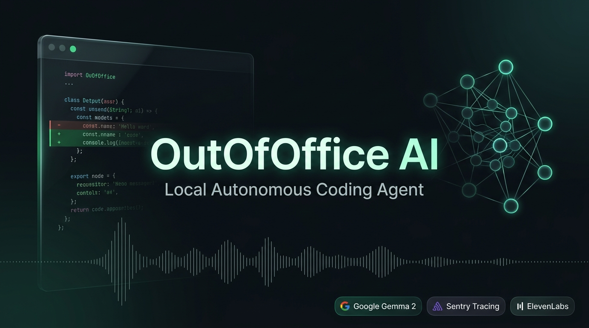

# OutOfOffice AI (OOO)

Local-First Autonomous Coding Agent Powered by Google Gemma 2, Sentry Agent Tracing, and ElevenLabs.



## Overview

Modern AI coding tools suffer from a common limitation: they demand constant developer presence. Developers spend hours waiting for tokens to stream, reviewing single-line completions, and babysitting chat prompts.

OutOfOffice AI (OOO) flips this workflow. It is an autonomous, local-first developer agent designed for asynchronous execution:

1. Target any local Git repository and set a maintenance directive (dead code pruning, AST refactoring, test repair).
2. Step away from your desk while the agent executes locally on your hardware.
3. Return to an executive ElevenLabs audio debrief and inspect verified, branch-isolated syntax diffs.

No proprietary code is transmitted to cloud LLM APIs. All model inference runs on your machine via Google Gemma 2.

---

## Core Guarantees

* 100% Local Intelligence: Runs Google Gemma 2 locally through Ollama. Zero cloud token costs, zero latency overhead, and complete data privacy.
* Distributed Span Observability: Sentry Agent Tracing instruments every planning node, AST analysis pass, and tool call with microsecond accuracy.
* Executive Voice Debrief: ElevenLabs synthesizes a concise audio report upon return, detailing files inspected, bugs resolved, and repository health scores.
* Git Branch Isolation: Modifications never touch your working branch directly. Every run is isolated in a dedicated Git branch with automated AST syntax validation.
* Resilient Fallbacks: Seamless fallback to rule-based AST heuristics and Web Speech synthesis if local models or external APIs are unavailable.

---

## Architecture Pipeline

```text
[Local Repository] 
       |
       v
[AST Analyzer & Git Manifest]
       |
       v
[Planner Node (Google Gemma 2 via Ollama)]  <--- Sentry Distributed Tracing
       |
       v
[Execution & Repair Node]
       |
       v
[Verification Node (AST Syntax + Pytest)]
       |
       v
[Results Hub] ---> [ElevenLabs Voice Debrief]
              ---> [Branch-Isolated Unified Diffs (ooo/agent-audit)]
```

### Execution Flow

1. Repository Intake: Inspects local Git status, uncommitted changes, and parses the project Abstract Syntax Tree (AST) to index exported symbols, functions, and import dependencies.
2. Gemma 2 Autonomous Planning: Formulates a structured step-by-step execution plan based on the selected directive (AUDIT or FIX).
3. Branch-Isolated Modification: Creates a clean working branch (`ooo/agent-audit` or `agent/outofoffice-*`) and applies validated modifications.
4. AST Validation: Re-parses modified files through Python AST analyzers to verify that no syntax errors or invalid imports were introduced.
5. Synthesis & Debrief: Computes a codebase health score (0-100), logs end-to-end spans to Sentry, and streams an executive audio summary via ElevenLabs.

---

## Technology Stack

* Local LLM Runtime: Google Gemma 2:2b via Ollama
* Agent Orchestration: Python, FastAPI, StateGraph pipeline architecture
* Distributed Tracing: Sentry Python SDK (Custom Agent Tracing spans)
* Voice Synthesis: ElevenLabs Turbo API (`eleven_turbo_v2_5`) with Web Speech API fallback
* Static Analysis: Python Abstract Syntax Tree (`ast`), `gitpython`, `diff-match-patch`
* Frontend: React 18, TypeScript, Tailwind CSS, Vite, Lucide Icons

---

## Prerequisites

Before running OutOfOffice AI, ensure your system has:

* Python: 3.10 or higher
* Node.js: 18.x or higher and npm
* Git: Installed and available in your system PATH
* Ollama: Installed and running locally ([ollama.com](https://ollama.com))

Pull the Google Gemma 2 model:

```bash
ollama pull gemma2:2b
```

Verify that Ollama is serving requests:

```bash
curl http://localhost:11434/api/tags
```

---

## Quick Start

### 1. Clone the Repository

```bash
git clone https://github.com/Samar-365/OutOfOffice-.git
cd OutOfOffice-
```

### 2. Configure Environment Variables

Copy the example environment file and configure your credentials:

```bash
cp .env.example .env
```

Edit `.env` to configure your settings:

```ini
# Server
HOST=127.0.0.1
PORT=8000
ENVIRONMENT=development

# Ollama / Local Models
OLLAMA_BASE_URL=http://localhost:11434
DEFAULT_MODEL=gemma2:2b
FALLBACK_MODEL=gemma2:2b

# Sentry Distributed Tracing
SENTRY_DSN=your_sentry_dsn_here
SENTRY_TRACES_SAMPLE_RATE=1.0

# ElevenLabs Audio Debrief
ELEVENLABS_API_KEY=your_elevenlabs_api_key_here
ELEVENLABS_VOICE_ID=21m00Tcm4TlvDq8ikWAM
ELEVENLABS_MODEL_ID=eleven_turbo_v2_5
```

Note: If an ElevenLabs API key is not supplied, the system automatically falls back to browser-native Web Speech synthesis. If Sentry DSN is omitted, tracing operates in local mock mode without throwing errors.

### 3. Backend Setup

Create a Python virtual environment and install dependencies:

```bash
python -m venv venv

# Windows (PowerShell)
.\venv\Scripts\Activate.ps1

# Linux / macOS
source venv/bin/activate

pip install -r backend/requirements.txt
```

Start the FastAPI daemon:

```bash
python -m uvicorn backend.app.main:app --reload --port 8000
```

The API documentation will be available at `http://127.0.0.1:8000/docs`.

### 4. Frontend Setup

In a separate terminal, install dependencies and launch the development server:

```bash
cd frontend
npm install
npm run dev
```

Open `http://localhost:5173` in your browser.

---

## User Interface Overview

* Overview (Landing Page): Minimalist high-level introduction highlighting local execution, zero cloud data egress, and the 4 architecture pillars.
* Mission Control (Dashboard): Repository intake interface with real-time Git validation, model selection (Gemma 2:2b), task mode presets, and execution controls.
* Telemetry: Interactive waterfall chart displaying microsecond span timing for each agent node (PlannerNode, AST analysis, tool calls).
* Results Hub: Playable ElevenLabs audio debrief player, codebase health score (0-100), away duration counter, and a unified diff viewer with branch merge and discard controls.

---

## API Endpoints Reference

| Method | Endpoint | Description |
|---|---|---|
| GET | `/api/health` | Health check and Ollama connectivity status |
| POST | `/api/repos/validate` | Validates target path as a clean Git repository |
| POST | `/api/jobs` | Dispatches an autonomous agent execution job |
| GET | `/api/jobs/{job_id}` | Retrieves job status, steps, diffs, and report |
| GET | `/api/jobs/{job_id}/traces` | Retrieves Sentry-instrumented waterfall trace spans |
| GET | `/api/jobs/{job_id}/audio-strategy` | Retrieves ElevenLabs audio stream URL or fallback payload |
| POST | `/api/jobs/{job_id}/cancel` | Terminates an active running agent job |

---

## Running Automated Tests

Run the backend test suite:

```bash
pytest backend/tests -v
```

Validate the frontend production build:

```bash
cd frontend
npm run build
```

---

## Hacktoberfest 2026 Submission

This project was built for the Hacktoberfest 2026 Open-Source AI Challenge: Week 1 ("Touch Grass").

* Theme Alignment: Makes screen time the shortest part of development. Developers step away from the monitor, let local Gemma 2 handle maintenance tasks, and return to an executive audio debrief.
* Open Innovation: Proves that developer tooling does not require closed cloud APIs. Open-weight models running on local consumer hardware provide complete privacy, zero token fees, and offline reliability.

Partner Categories:
* Best Use of Gemma: Powered by Google Gemma 2:2b running locally through Ollama.
* Best Use of Sentry Agent Tracing: Microsecond span instrumentation across all agent reasoning and execution nodes.
* Best Use of ElevenLabs: Executive audio debrief synthesized via ElevenLabs Turbo API.

---

## License

This project is licensed under the Apache License 2.0. See the LICENSE file for details.
